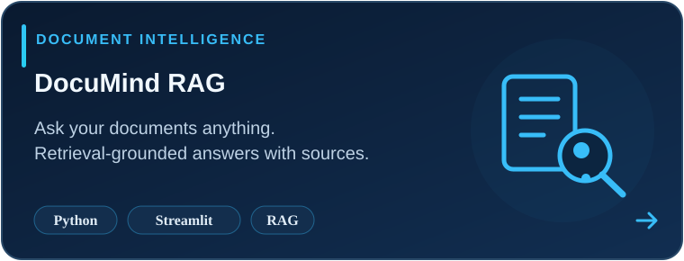
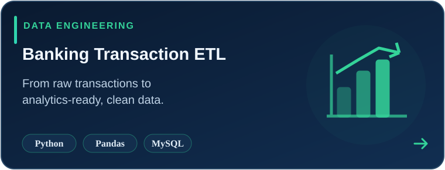
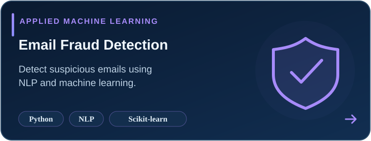
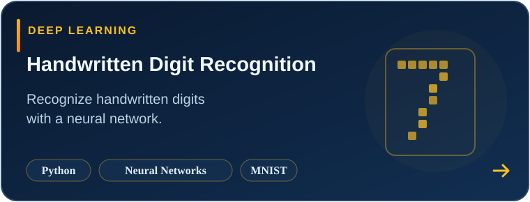

<!-- Premium GitHub Profile — Nusaik Ahamath -->

  

  

  
  
  

### 👋 About me

I'm **Nusaik Ahamath**, a **BSc (Honours) in Data Science undergraduate** at **Sri Lanka Technological Campus (SLTC)**, graduating in **2028**.

I turn data into useful solutions — from exploring patterns and training models to building practical AI apps and dashboards.

- 🔭 **Currently exploring:** Retrieval-Augmented Generation (RAG), NLP and applied machine learning
- 🧩 **I enjoy:** Data analysis, Python, real-world problem solving and simple, usable interfaces
- 🤝 **Open to:** Data Science, Machine Learning and Data Analyst internships
- 📍 **Based in:** Sri Lanka

> **My approach:** Understand → Explore → Build → Evaluate → Improve.

---

### 🚀 Selected projects

<!-- These project cards are stored inside this repository, so they do not depend on third-party card servers. -->
<table>
  <tr>
    <td width="50%" valign="top">
      
    </td>
    <td width="50%" valign="top">
      
    </td>
  </tr>
  <tr>
    <td width="50%" valign="top">
      
    </td>
    <td width="50%" valign="top">
      
    </td>
  </tr>
</table>

**[→ Explore all my repositories](https://github.com/nusaikaj?tab=repositories)**

---

### 🧰 Tech stack

**Languages & data**

**Apps, analytics & databases**

---

### 📊 GitHub at a glance

  
  

*Stats are provided by a third-party service and might occasionally be unavailable.*

---

### 🐍 Contributions in motion

<!-- Uses your EXISTING contribution snake from the output branch. No new workflow required. -->

  

---

<strong>Build with curiosity. Learn through projects. Improve with feedback.</strong>

  <a href="https://nusaik-portfolio.vercel.app/">Portfolio</a> ·
  <a href="https://www.linkedin.com/in/nusaik-ahamath">LinkedIn</a> ·
  <a href="https://www.kaggle.com/nusaikahamath">Kaggle</a>

